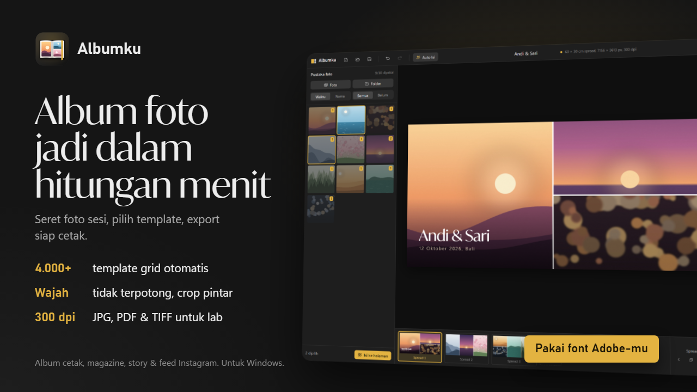

# Albumku

Aplikasi desktop Windows untuk menyusun album foto cetak, magazine, story, dan feed Instagram dari ribuan template grid. Dibuat untuk fotografer: seret foto sesi, pilih template, export siap cetak.



## Fitur

- **±4.000–5.400 template per format**, dibuat otomatis dan disesuaikan dengan orientasi foto dan posisi wajah. Ada mode spread bentang penuh, per halaman, dan magazine (dengan ruang kosong untuk teks).
- **Format**: album 20×30 / 30×30 / 40×30 cm atau ukuran manual (landscape/portrait, spread, bleed), magazine A4/Letter, Story 9:16, Feed 4:5 / 3:4 / 1:1, Carousel seamless, Puzzle feed 3 kolom.
- **Auto Isi**: foto dikelompokkan per momen dari jam jepret (EXIF) lalu disusun otomatis.
- **Smart crop wajah**: wajah dideteksi saat import supaya tidak terpotong.
- **Edit foto di sel**: geser, zoom, tukar, luruskan (rotasi ±45° dan 90°).
- **Teks** dengan semua font Windows dan Adobe Fonts yang aktif di Creative Cloud, gradient, outline, dan bayangan.
- **Palet warna** siap pakai, diambil dari foto, atau palet sendiri. Juga background gradient dan overlay untuk caption.
- **1.149 bingkai vektor**: garis, ornamen sudut (bisa dipilih per pojok), pola, passe-partout, polaroid. Warna emas metalik, perak, rose gold, atau warna bebas.
- **Feed Planner**: pratinjau grid profil Instagram.
- **Drag & drop** foto atau folder langsung dari Windows Explorer.
- **Export** JPG 4:4:4, TIFF, dan PDF multi-halaman 300 dpi dengan TrimBox/BleedBox untuk lab cetak.
- Tema gelap, terang, atau mengikuti Windows.

## Instalasi

Unduh installer `Albumku_<versi>_x64-setup.exe` atau ZIP portable dari halaman Releases. Butuh Windows 10/11 dengan WebView2 (sudah terpasang di Windows 11).

## Pengembangan

Tauri 2 + React + TypeScript + Tailwind, backend Rust murni (tanpa Python).

```bash
npm install
npm run tauri dev     # mode pengembangan (port 1460)
npm run tauri build   # installer NSIS di src-tauri/target/release/bundle/nsis
```

| Bagian | Lokasi |
|---|---|
| Generator template | `src-tauri/src/layouts.rs` |
| Import foto, EXIF, deteksi wajah | `src-tauri/src/photos.rs` |
| Daftar font Windows + Adobe Fonts | `src-tauri/src/fonts.rs` |
| Encoder JPG/TIFF/PDF | `src-tauri/src/export.rs` |
| Renderer kanvas (editor = export) | `src/lib/render.ts` |
| Generator bingkai | `src/lib/frames.ts` |

Deteksi wajah memakai model SeetaFace frontal dari [rustface](https://github.com/atomashpolskiy/rustface) (BSD-2-Clause), tertanam di `src-tauri/models/`.
